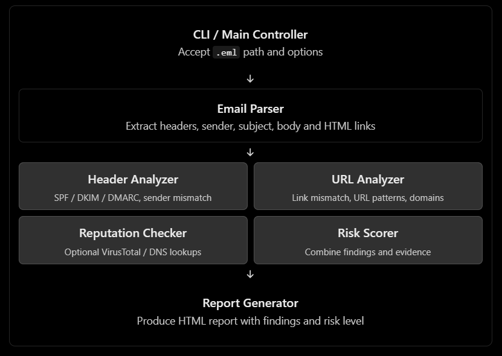
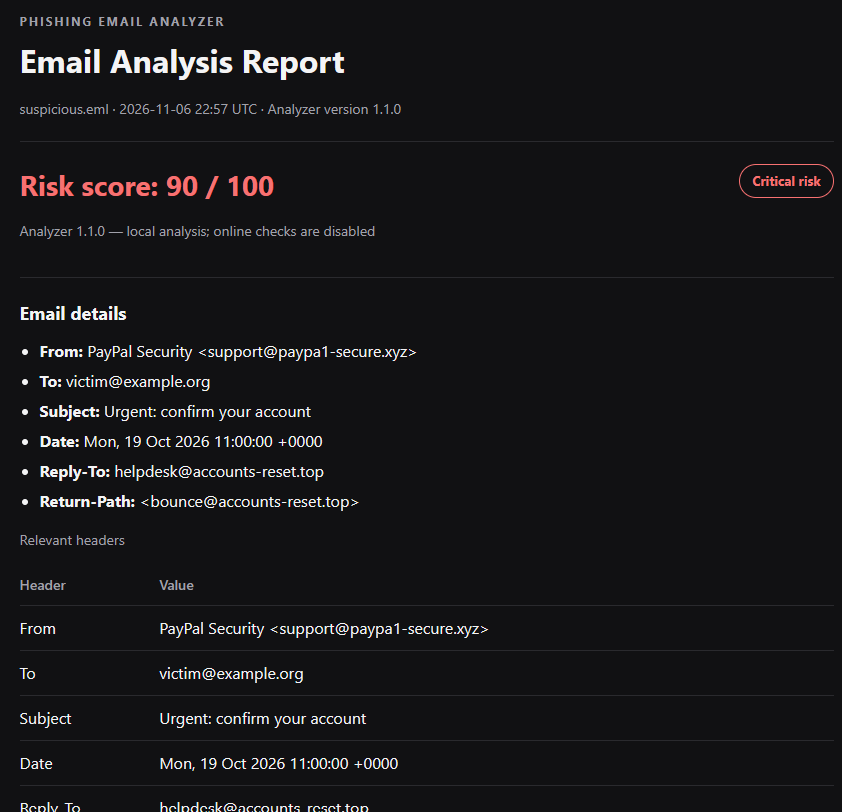

# Phishing Email Analyzer


## Overview

Phishing Email Analyzer is a Python-based tool for analyzing `.eml` files, examining email headers, SPF/DKIM/DMARC authentication results, and extracting and analyzing URLs and domains. It generates comprehensive HTML reports with risk assessments, performs DNS checks and VirusTotal reputation lookups by default when configured, and supports fully offline analysis via `--offline-checks`.

## Architecture



## Features

| Check | Details |
| --- | --- |
| Email | Headers, body, links, and existing SPF/DKIM/DMARC authentication results |
| URLs | Link-text mismatch, IP hosts, shorteners, punycode, risky schemes, and suspicious TLDs |
| DNS | Current SPF, DKIM-selector, and DMARC TXT records (online by default) |
| VirusTotal | Existing URL and domain reports when a key is configured |
| Report | HTML findings, evidence, limitations, and risk score |

Missing records and unavailable lookups do not add risk points. Current DNS records do not re-validate authentication of the received email.

## Requirements

- Python 3.10 or later
- Internet access for online checks (enabled by default; use `--offline-checks` to run locally)
- A VirusTotal account and API key for VirusTotal lookups

Offline analysis works without a VirusTotal account, API key, or internet access.

## Installation and Setup

```powershell
py -3.10 -m venv .venv
.venv\Scripts\Activate.ps1
python -m pip install -e .
```

### Configure VirusTotal API Key

Use `.env.example` and rename it to `.env`. Replace `YOUR_VIRUSTOTAL_API_KEY` with your actual VirusTotal API key. 

Then run:

```powershell
python -m phishing_analyzer samples\suspicious.eml
```

## Usage

```powershell
python -m phishing_analyzer samples\suspicious.eml
```
> VirusTotal lookups are subject to API quotas. Use `--offline-checks` to run in local environment.

By default, the report is saved to `reports\<email-name>.html`. To specify the report name and directory, run:

```powershell
python -m phishing_analyzer samples\benign.eml -o reports\benign.html
```

To analyze an `.eml` file outside the project directory and save the report to a custom
directory paths:

```powershell
python -m phishing_analyzer "C:\Users\YourName\Downloads\suspicious.eml" -o "C:\Users\YourName\Documents\Phishing Reports.html"
```

### Sample Report



## More information

- [Risk score](docs/risk-scoring.md): scoring criteria and categories.
- [Versioning](docs/versioning.md): release history and version command.
- [Tests](docs/testing.md): test and lint instructions.


---

<div align="center">
  <sub> Created by <a href="https://github.com/n-afiqa/">@n-afiqa</a> · © 2026</sub>
</div>